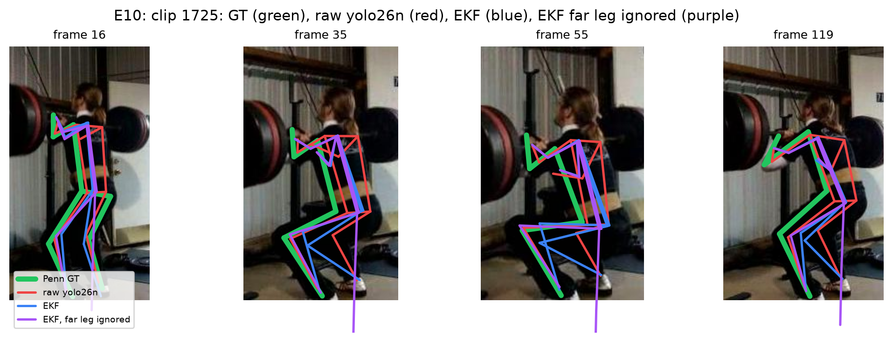
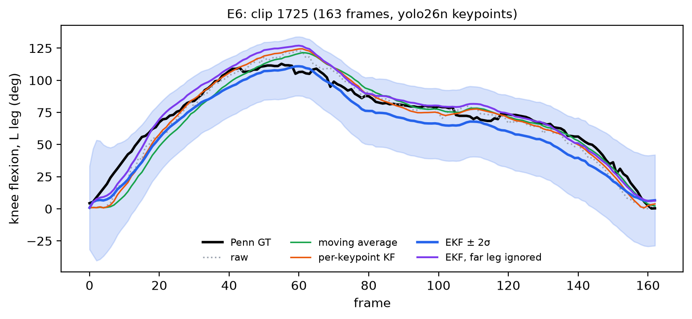
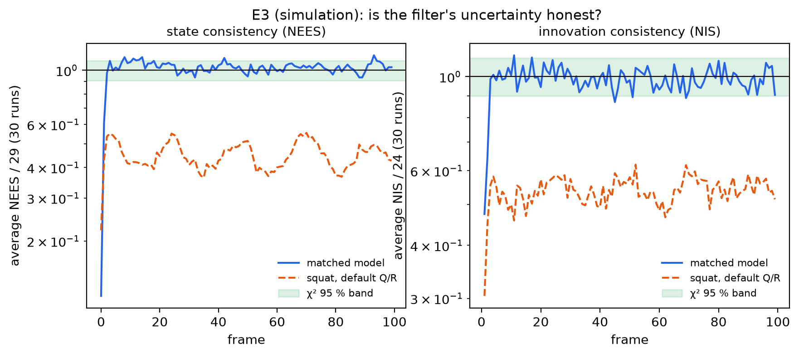
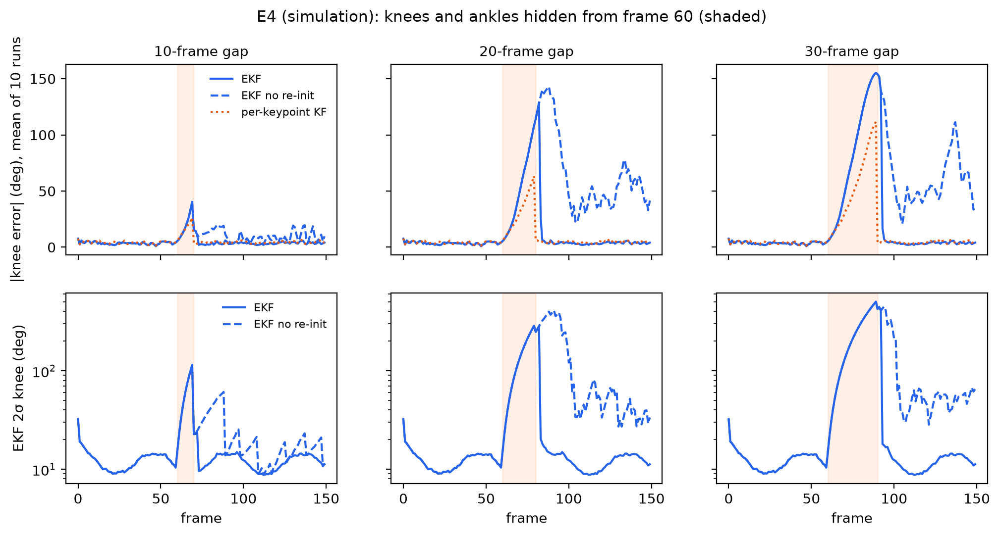

# Kinematically Constrained EKF for Human Joint-Angle Estimation from Monocular Video

An Extended Kalman Filter that turns noisy, frame-by-frame **YOLO26-Pose** keypoints into
**smooth, physically consistent joint angles** with calibrated uncertainty. The filter
tracks a planar skeleton with rigid bones, adapts its trust to each keypoint's
confidence, rejects outliers, and coasts through occlusions. It runs at **~0.5 ms per
frame** on a laptop CPU.

Evaluated on side-view squats from the [Penn Action](https://dreamdragon.github.io/PennAction/)
dataset, and on a simulator with known ground truth.

<p align="center">
  
</p>

## Highlights

| | Raw YOLO26n | **EKF** |
|---|---|---|
| Knee-angle jitter (deg/frame², lower is smoother) | 5.41 | **1.30**, 4× smoother |
| Bone-length variation (CV %, ground truth ≈ 9.3) | 11.1 | **4.8**, rigid bones |
| Frames with an estimate (coverage %) | 99.3 | **99.9**, coasts through gaps |
| Filter cost per frame | n/a | **0.52 ms**, so YOLO26n + EKF runs at ~160 fps |

On the simulator:
- **Consistent uncertainty:** with a matched model, NEES/dim = 1.03 and NIS/dof = 0.99, with about 94% of frames inside the 95% χ² band.
- **Better angles than every baseline:** knee error is 5.1° for the EKF, 7.0° for the per-keypoint KF, and 9.6° for raw keypoints.
- **Recovery after occlusion:** after a 20-frame occlusion of both legs, error 20 frames later is 23° with track-loss recovery, against 114° without it.

## How it works

```
video frame ─► YOLO26-Pose (predict only) ─► 12 body keypoints + confidences
                                                   │
         ┌─────────────────────────────────────────▼──────────────────────┐
         │ EKF on a 29-D planar skeleton                                  │
         │   predict : constant-velocity model, white-noise-accel. Q      │
         │   update  : confidence mask → adaptive R → per-keypoint NIS    │
         │             gate (χ²₂ 99%) → Joseph-form update                │
         │   constrain: wrap angles, clamp lengths, joint limits          │
         │   recover : re-initialise a limb gated N frames in a row       │
         └─────────────────────────────────────────┬──────────────────────┘
                                                   ▼
                     knee / hip flexion angles ± uncertainty
```

- **State (29-D):**
  - root position (2)
  - 9 absolute segment angles: torso, upper and lower arms, thighs, shanks
  - their 11 velocities
  - 7 bone lengths
- **Measurement model:** forward kinematics h(x) gives 12 keypoints (24 numbers), with an analytic Jacobian. It is checked against finite differences in `tests/test_jacobian.py`.
- **Adaptive R:** σⱼ = σ₀ · √(1 + α(1 − cⱼ)), so a less confident keypoint gets a larger σ.
- **Per-keypoint gating:** each keypoint is tested on its own 2×2 innovation block. One wild detection is rejected without discarding the rest of the frame.
- **Track-loss recovery:** after a long occlusion, a linearised filter can keep rejecting the returning keypoints indefinitely. A limb whose confident keypoints are gated `reinit_after` frames in a row is re-initialised from the measurement.

## Results

All numbers come from `python -m experiments.exp_sim` and `python -m experiments.exp_real run`.
Tables are written to `results/tables/` and figures to `report/figures/`.

### Real data: 37 Penn Action test clips (side-view squats), YOLO26n

| Method | Knee RMSE median (°) | Hip RMSE median (°) | Knee jitter | Bone CV (%) | Lag (frames) |
|---|---|---|---|---|---|
| Raw YOLO | 9.60 | 10.11 | 5.41 | 11.13 | −0.16 |
| Moving average (w = 7) | 13.16 | 11.89 | 1.30 | 10.85 | 0.57 |
| Per-keypoint KF | 10.87 | 10.77 | 1.12 | 11.38 | 0.16 |
| **EKF** | 12.86 | 12.08 | 1.30 | 4.79 | 0.24 |
| EKF, occluded leg masked | 9.35 | 10.57 | 1.23 | 3.74 | 0.32 |

Parameters were tuned on 10 separate tuning clips only: σ₀ = 16 px, σ_α = 0.02 rad/frame².
The plain EKF's knee and hip error is analysed under [Limitations](#limitations).

<p align="center">
  
</p>

### Simulation: known ground truth

| Experiment | Figure |
|---|---|
| E1: angle traces with ±2σ bands | `report/figures/e1_sim_angles.png` |
| E2: process-noise × measurement-noise sweep | `report/figures/e2_sim_sweep.png` |
| E3: NEES / NIS consistency, 30 Monte-Carlo runs | `report/figures/e3_consistency.png` |
| E4: occlusion of knees and ankles for 10 / 20 / 30 frames | `report/figures/e4_occlusion.png` |

<p align="center">
  
  
</p>

Simulated ablation on the "realistic" scenario (20 seeds: noisy confidences, 5% missed keypoints, 4% confident outliers):

| Method | Knee RMSE (°) | Hip RMSE (°) | Knee jitter |
|---|---|---|---|
| Raw | 9.58 | 8.06 | 17.13 |
| Per-keypoint KF | 7.03 | 5.75 | 7.21 |
| **EKF (full)** | **5.10** | **3.63** | **4.74** |
| EKF, fixed R | 5.43 | 3.82 | 5.45 |
| EKF, no gating | 5.62 | 3.90 | 5.09 |
| EKF, fixed R + no gating | 5.90 | 4.00 | 5.93 |

### Edge deployment (RTX 2050 laptop GPU, i5-12450H CPU)

| Pipeline | YOLO (ms) | EKF (ms) | Total (ms) | Knee jitter |
|---|---|---|---|---|
| YOLO26n | 5.71 | n/a | 5.71 | 5.41 |
| YOLO26n + EKF | 5.71 | 0.52 | 6.23 | 1.30 |
| YOLO26x | 57.91 | n/a | 57.91 | 2.68 |
| YOLO26x + EKF | 57.91 | 0.51 | 58.42 | 0.81 |

**YOLO26n + EKF is smoother than YOLO26x on its own** (jitter 1.30 vs 2.68), at about 1/9 of the compute.

## Limitations

- **Self-occluded far leg.** In side views YOLO reports the hidden far leg with about 95% confidence, though the positions are guesses. The EKF shares bone lengths between left and right, so these guesses corrupt the near leg. That is why the plain EKF's knee RMSE (12.86°) is above raw YOLO's (9.60°).
  - Masking the occluded leg restores accuracy (9.35°).
  - Which leg is hidden can be read from the person's facing direction in the YOLO output; this matched Penn's camera label in 47/47 clips.
- **Planar model with constant bone lengths.** Foreshortening changes the projected thigh length by 55–85 px within one clip. Ground truth itself has a bone CV of 9.3%, so a rigid 2-D skeleton cannot fit every frame exactly.
- **Re-initialisation is a heuristic.** A UKF, a particle filter or a multiple-hypothesis tracker could represent the curved post-occlusion uncertainty properly.
- **Scope.** Only side-view squats from Penn Action were evaluated.

**Future work.** Add a fixed-lag Rauch–Tung–Striebel smoother after the EKF, together with automatic masking of the occluded limb. A preliminary run with a 10-frame lag (about 0.33 s at 30 fps) gave knee/hip median errors of 7.94° / 9.72°, against 9.60° / 10.11° for raw YOLO, with jitter 0.68. The lag was chosen on the test clips, so these numbers are indicative only.

## Repository layout

```
ekf/            skeleton.py (state, FK, Jacobian, IK init, constraints)
                models.py   (F, Q, adaptive R, EKFParams)
                ekf.py      (PoseEKF: predict / gate / update / recovery / run)
baselines/      moving_average.py, kf_per_keypoint.py
eval/           metrics.py  (angle RMSE, jitter, lag, keypoint RMSE, bone CV, NEES, χ² band)
sim/            simulate.py (synthetic squats, detector noise, occlusion, outliers)
data_io/        penn.py     (Penn Action loading, L/R mirror fix, clip selection)
pose/           run_pose.py (YOLO26-Pose inference → cached keypoints)
experiments/    exp_sim.py (E1–E5), exp_real.py (tune, E5–E8, E10)
tools/          inspect_penn.py (dataset index)
tests/          Jacobian, EKF and metric tests
report/figures/ generated figures
```

## Reproducing

**Setup** (Python 3.11):
```bash
python -m pip install -r requirements.txt
```
Put the Penn Action dataset in `data/Penn_Action/`, with `frames/` and `labels/` inside.
Put the `yolo26n-pose.pt` and `yolo26x-pose.pt` weights in `weights/`.

**Pipeline:**
```bash
python tools/inspect_penn.py --root data/Penn_Action   # index the dataset   -> results/penn_index.csv
python -m data_io.penn                                 # pick test/tune clips -> results/clips_*.csv
python -m pose.run_pose                                # YOLO inference cache -> results/keypoints/ (slow, resumable)

python -m pytest tests -v                              # 45 tests
python -m experiments.exp_sim                          # simulation E1–E5, ~40 s
python -m experiments.exp_real tune                    # grid search on tuning clips
python -m experiments.exp_real run                     # real-data E5–E8, E10
```

Notes on the data:
- Penn Action's left/right labels are mirrored relative to the COCO/YOLO convention. `data_io/penn.py` swaps them by default; the swap lowers the GT-vs-YOLO error in 47/47 clips.
- Ultralytics is used only for `model.predict()`. All filtering, tracking and evaluation is implemented here.

## Acknowledgements

Penn Action dataset: W. Zhang, M. Zhu, K. Derpanis, *"From Actemes to Action: A
Strongly-supervised Representation for Detailed Action Understanding"*, ICCV 2013.
Pose estimation: [Ultralytics YOLO26](https://github.com/ultralytics/ultralytics).

## License

Apache License 2.0, see [LICENSE](LICENSE).
